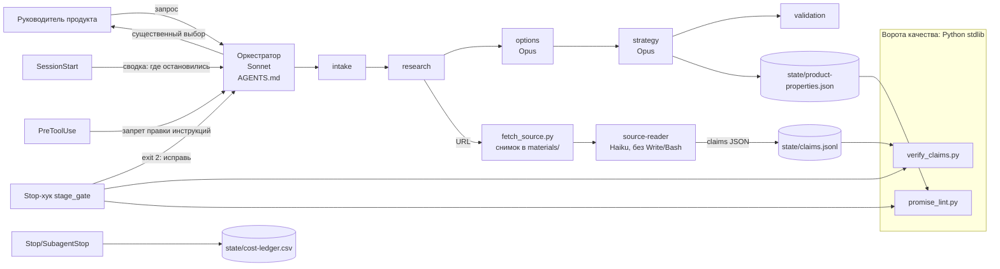

# План: агент «Стратег Фабрики продуктов»

Дата: 17.11.2026. Сдача: 22.11.2026 23:59 МСК (docs/deadline.env). Feature freeze: 20.11 20:00.
Основание выбора: docs/ideas/critique.md §5 (ядро + «ворота качества»). Требования: docs/00-brief.md §4–§8.

## Демо-момент одной фразой
Обычный чат обещает «Маме не нужно ничего настраивать» и «Ева не позволит мошенникам до неё дозвониться», а по открытым источникам родственник подтверждает согласие СМС-кодом и порядка 10% мошеннических звонков Ева разрывает уже во время разговора; агент строит обещания только из реестра свойств продукта, недоказанное отправляет в план проверки, и линтер подтверждает это за секунду без LLM (у чата из 13 обещаний 2 опираются на свойства, 2 противоречат фактам; у агента 4 из 4 плюс 2 теста сообщения).

> Уточнено 17.11 по реальному ответу чата (`tests/fixtures/demo/baseline/`): чат избегает слов «100%» и «лучший», поэтому разница не в лексике, а в том, что обещания шире свойств продукта или противоречат им.

## Что делаем

### Must (до feature freeze)
1. **5 скиллов-этапов** в `.claude/skills/`: `intake` → `research` → `options` → `strategy` → `validation`. У каждого шаблон артефакта и точка подключения человека.
2. **Раздельное хранение:** инструкции (`AGENTS.md`, `CLAUDE.md`, `.claude/`), методика (`methodology/`), материалы (`projects/<задача>/materials/`), состояние (`projects/<задача>/state/`), результаты (`projects/<задача>/out/`).
3. **Продолжение после перерыва:** SessionStart-хук печатает «где остановились, что дальше» из `state/`.
4. **Стоимость:** Stop/SubagentStop-хук пишет `state/cost-ledger.csv` (токены по моделям из транскрипта × прейскурант API), `scripts/cost_report.py`.
5. **Маршрутизация моделей:** оркестратор Sonnet, `source-reader` Haiku, `options` и `strategy` Opus.
6. **Защита от prompt injection:** `source-reader` без Write/Bash/Edit; снимки источников сохраняет скрипт, а не модель; PreToolUse-хук запрещает правку `AGENTS.md`, `CLAUDE.md`, `.claude/**`, `methodology/**`; PostToolUse помечает материалы как недоверенные; 2 страницы-ловушки в демо.
7. **Ворота качества на чистом Python (stdlib):** `verify_claims.py` (Протокол доказательств-lite), `promise_lint.py` (Сверка обещаний), Stop-хук `stage_gate.py` с exit 2.
8. **Демо-проект** на открытых данных: «Защита близких» в ассистенте Ева, снимки источников с URL и датой, реестр свойств, claims, ответ обычного чата.
9. **Юнит-тесты** (`unittest`) на все скрипты, запуск без LLM.
10. **README** с запуском за 5 минут, AGENTS.md для Cursor, описание решений.

### Should (если останется время до freeze)
- `compare.py`: тот же запрос в обычном чате → те же проверки → таблица «агент / чат».
- Скилл синтетических интервью: реплики с меткой `synthetic`, verify_claims не даёт им стать основанием факта.
- «Живая стратегия»-lite: решения в `state/decisions.md` с основаниями (ID claims) и kill-критериями; `revisit.py` находит решения, чьи основания понижены, отозваны или оспорены новым claim; сводка в SessionStart.

### Won't (осознанно не делаем)
Граф `depends_on`, eval на 6+ задачах с судьёй, режимы глубины, обязательный Jev (максимум интерфейс `decide` с бэкендом Haiku), полноценный перенос хуков в Cursor (в Cursor работают инструкции и Python-проверки, хуки — только в Claude Code), MCP-серверы, UI.

## Критерий §8 → фича

| Критерий (§8) | Что жюри проверяет | Чем закрываем |
|---|---|---|
| 1. Проработанность | выводы связаны с источниками; факт ≠ гипотеза ≠ прогноз; ≥3 разных варианта и возражения; стратегии согласованы; обещания = продукт; план проверки | `claims.jsonl` + `verify_claims.py` (понижение факта без снимка до гипотезы); шаблон `options` (статус-кво, «закрыть направление», «что должно быть правдой», pre-mortem); `product-properties.json` + `promise_lint.py`; скилл `validation` (контроль, срок, guardrails) |
| 2. Нейротехнологии | агентная система, контекст и знания, доп. уровень | 5 скиллов, субагент-карантин, 4 вида хуков, маршрутизация Haiku/Sonnet/Opus, методика отдельно, память со статусами и отзывом (`superseded`), синтетические интервью (Should), пересмотр решений (Should), сравнение с чатом (Should) |
| 3. Имплементация | запуск по инструкции; сквозной путь; продолжение после перерыва; секреты; новые задачи | README «5 минут», `scripts/project.py new`, SessionStart-сводка, `.env` не нужен для базового пути, шаблон `_template`, проверки работают на любой задаче |
| 4. Качество | время и расходы; польза компонентов; человек может остановить и исправить; результат пригоден для решения | `cost-ledger.csv` + `cost_report.py`; точки выбора человека в каждом скилле; журнал `state/journal.md`; итоговый `out/` в Markdown; цифры сравнения с чатом |

## Архитектура

## Таймлайн (один человек, параллельно трек 2)

| День | Что | Готово, когда |
|---|---|---|
| 17.11 вт | План, сценарий видео, перестройка структуры, ядро: скиллы, хуки, source-reader, state; ворота на Python, тесты, демо-материалы | `python3 -m unittest` зелёный, хуки отвечают на тестовый JSON, push |
| 18.11 ср | Сквозной прогон в Claude Code на демо-задаче, правка скиллов по ошибкам; compare, Should-фичи | демо-проект пройден от запроса до плана проверки без ручных обходов |
| 19.11 чт | Прогон на второй задаче (новой, не демо); бриф МегаФона, если опубликован; проверка в Cursor | 2 задачи в `projects/`, скрин Cursor |
| 20.11 пт | **Feature freeze 20:00.** Черновая запись видео по pitch/demo-script.md | черновик видео ≤10 мин |
| 21.11 сб | Описание работы (PDF): архитектура, модели, промпты, расходы, ошибки, ограничения; финальное видео | PDF и видео загружены |
| 22.11 вс | Буфер, проверка README на чистом клоне, сдача капитаном | сдано до 23:59 МСК |

## Порядок урезания (если не успеваем)
1. Сначала режем «Живую стратегию»-lite.
2. Затем синтетические интервью.
3. Затем `compare.py` (оставляем ручную таблицу из двух прогонов проверок).
4. Затем PostToolUse-маркировку недоверенных данных (остаётся карантинный субагент и PreToolUse-запрет).
5. Не режем никогда: 5 скиллов, state + SessionStart, cost-ledger, verify_claims, promise_lint, демо-проект, видео.

## Риски
- **Бриф демопроекта МегаФона не опубликован.** Демо на открытом сюжете «Защита близких»; на бриф резерв 0,5 дня 19–21.11.
- **Бан аккаунта Claude.** Видео пишем рано; проверки — чистый Python и работают без LLM; AGENTS.md читается Cursor.
- **Стоимость на подписке не биллинг.** В ledger и описании пишем «оценка по прейскуранту API».
- **Ложные «не найдено» на русском.** Проверяем числа и имена собственные по основе слова, а не фразу целиком; статус «проверено человеком».
